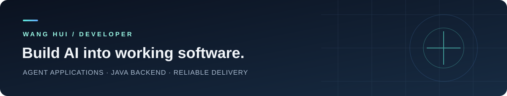

  

<h1 align="center">Hi, I'm 王慧 👋</h1>

  <strong>Agent 应用开发 · Java 后端 · AI 辅助开发</strong> 
  2027 届网络工程本科 · 寻找实习与校招机会

  
  
  
  
  
  

## About · 关于我

我关注 **AI 应用落地、异步任务处理与后端业务正确性**。有小团队实习和客户项目交付经历，从接手已有代码、补齐业务功能，到排查线上问题与验证修复，都有实际参与。

日常使用 Claude、Codex 辅助代码阅读、接口实现和测试补充，也通过代码审查、接口联调与回归测试验证结果。这里记录项目实现、个人贡献，以及开发中遇到的问题。

## Selected Work · 代表项目

### 01 / [MatrixShip · 矩阵星舰](https://github.com/ziyou-1/matrixship)

**AI 内容创作与任务执行平台**，由 Windows 桌面客户端、本机执行器和中心服务协同，支持内容采集、视频拆解及同款替换等流程。

- **我的参与：**接手已有项目继续开发，主要推进视频同款替换、Prompt 优化与相关接口联调。
- **技术与关注点：**Python · PySide6 · 本机浏览器执行 · 多端任务协同。

### 02 / 智能 AI 面试官

**Java / Spring AI 个人项目**，围绕简历分析、RAG 知识库、模拟面试与答案评估展开。

- **异步任务：**使用 Redis Stream 解耦简历分析、知识库向量化等耗时操作，实现消费者、ACK、失败重试及任务状态更新。
- **长文本评估：**设计每批 8 题的评估、总结归并与失败降级流程，在部分批次失败时保留可用结果。
- **技术：**Java 21 · Spring Boot · Spring AI · PostgreSQL · Redis。

本页仅介绍个人实现内容，暂未提供公开仓库链接。

### 03 / [FDC Store · 东南亚虚拟商品商城](https://github.com/ziyou-1/fdc-store)

**基于 dujiao-next 的客户项目二次开发**，面向虚拟商品下单、支付与自动发货，包含买家端及管理后台。

- **业务开发：**新增积分、限量领取、客服工单与 Token 商品等功能。
- **支付正确性：**接入 Payssion 本地钱包支付，区分原始交易金额与换汇结算金额，修正金额校验逻辑。
- **技术：**Go · Redis · SQLite · Vue 3 · TypeScript。

项目基于开源系统继续开发；原有系统能力与我的新增、修复内容分开说明。

## Internship · 实习协作

**AI 漫剧创作平台：**负责模型定价、缓存与计费逻辑，视频生成任务提交和状态轮询，以及画布自动保存与加载；参与 Prompt 组装接口、结果回调、Agent 工具调用链与 SSE 事件的测试及问题排查。

## Engineering Focus · 工程关注点

| 方向 | 我关注的问题 |
| :--- | :--- |
| AI 应用 | Prompt 组装、模型接入、工具调用与生成结果写回 |
| 异步任务 | 受理与执行解耦、任务状态、ACK、重试与失败降级 |
| 业务正确性 | 支付金额与币种口径、计费逻辑、项目与账号数据隔离 |
| 交付验证 | 接口联调、回归测试、Docker 部署与问题排查 |

## Notes & Contact · 记录与联系

- **学习记录：**[个人笔记](https://github.com/ziyou-1/yuque-notes)
- **求职方向：**Agent 应用开发 / Java 后端
- **邮箱：**[2240366036@qq.com](mailto:2240366036@qq.com)

---

把功能做出来，把问题讲清楚，把改动验证好。

